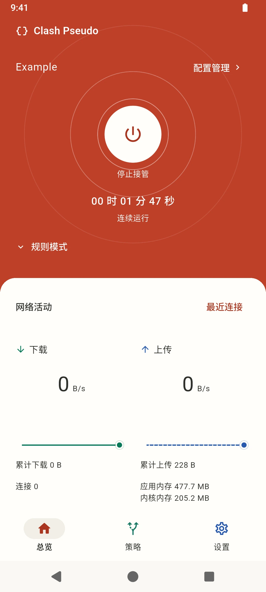
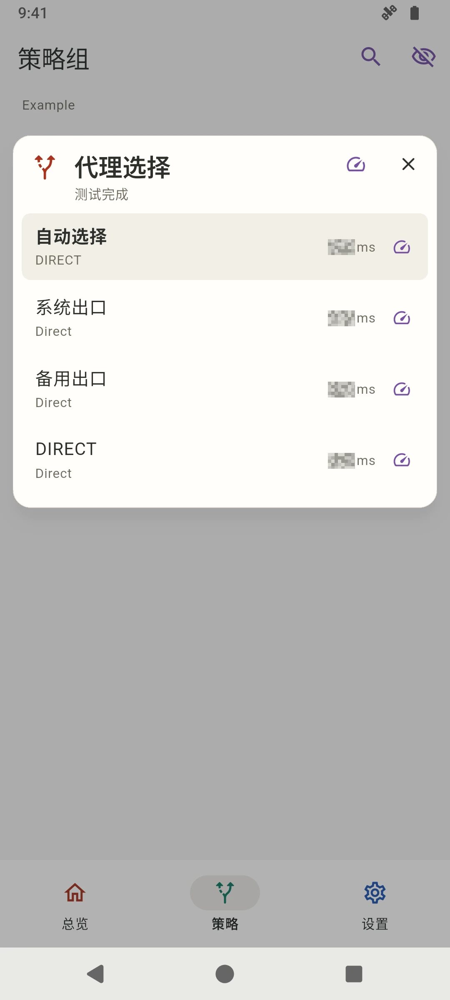
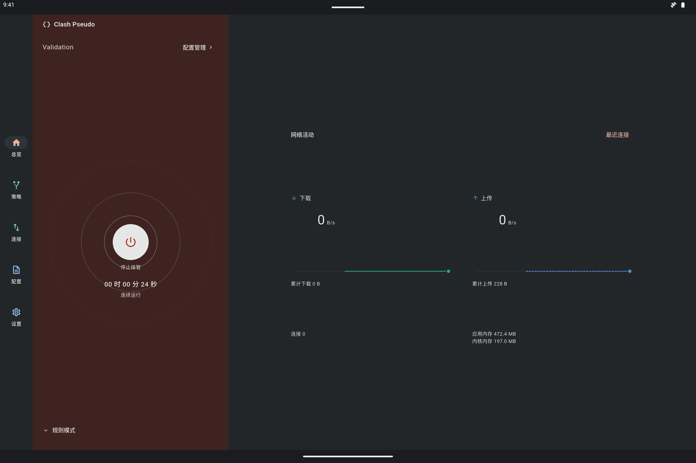
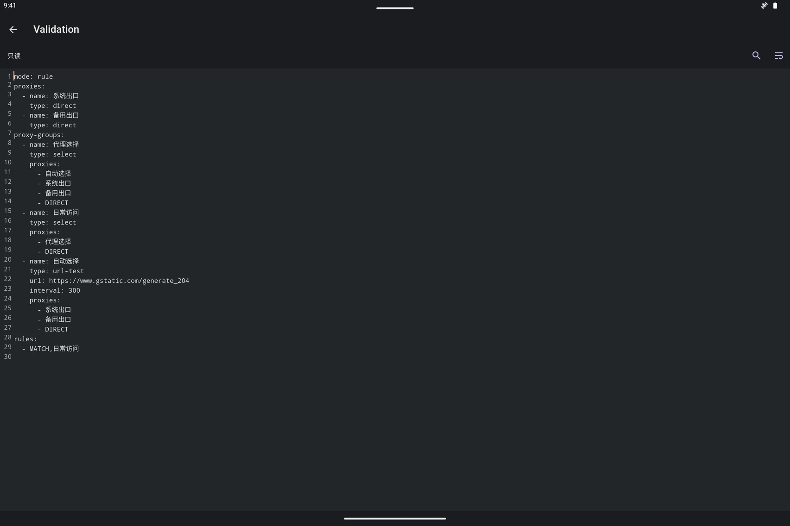

# Clash Pseudo

Clash Pseudo 是基于 mihomo 的 Android 网络接管与策略分流客户端，适用于手机与平板。提供配置导入与编辑、全局复写与本地定义、策略选择与 HTTP 延迟测试、实时连接管理以及网络诊断工具。

## 界面预览

  
  &nbsp;&nbsp;&nbsp;&nbsp;
  

  手机浅色界面：总览连接与网络活动 · 策略组选择与延迟测试

  
  &nbsp;&nbsp;&nbsp;&nbsp;
  

  平板深色横屏：双栏总览与流量面板 · YAML 正文编辑器

## 连接控制与策略选择

- **状态与流量总览**：集中展示接管状态、会话时长、上下行实时速率与趋势图、活跃连接数，以及应用与内核进程内存占用。
- **运行模式与策略分流**：支持规则、全局和直连模式切换；浏览策略组与成员节点，手动指定出口、恢复自动选择，或按组测试到 HTTP 目标的延迟。
- **异常恢复**：内核异常退出后保留当前页面与未保存编辑内容，可在总览直接重新启动、切换配置，或选择清理缓存与地理数据文件后恢复连接。

## 配置、复写与本地定义

- **多配置管理**：支持从 URL 或本地文件导入完整 mihomo 配置，管理多份配置并设置后台定时自动更新；内置带行号、查找与自动换行的 YAML 编辑器。
- **全局复写插件**：按顺序叠加多份 YAML 复写插件，支持导入 Loon 插件并转换兼容规则、指定目标策略及补充 `no-resolve`。
- **本地自定义表单**：通过结构化表单或原文字段创建和编辑代理节点、策略组、分流规则及 provider，自动合并到运行配置。

## 网络活动与诊断工具

- **近期连接与快速分流**：实时搜索目标地址、应用或规则，按状态筛选连接记录，查看完整分流链路与上下行流量，支持断开单条或全量连接，并可从连接详情直接生成分流规则加入本地定义。
- **全链路诊断**：查看当前配置与 provider 展开后的有效节点、实际生效的规则集、外部资源（proxy/rule provider 与 Geo 数据库）状态与更新、内核运行配置、实时内核日志以及多服务器并发 DNS 查询；所有原始数据与错误详情均支持展开阅读与复制。

## 局域网代理服务

- **多网卡共享**：通过 Wi-Fi、手机热点或 USB 共享网络等本地接口地址提供 HTTP 与 SOCKS5 代理服务，供同一局域网内的其他设备接入。
- **独立运行**：支持多地址绑定、自定义端口与 SOCKS5 UDP 转发，可独立于本机 VPN 接管开启或停止。

## Android 集成与个性设置

- **系统级控制**：支持按应用设置 VPN 接管范围（全部应用、仅选定应用或排除选定应用），配合 Android Always-on VPN、快捷设置磁贴与桌面小组件快速控制连接。
- **多形态自适应与备份**：提供系统／浅色／深色外观、多套主题色及中英文界面，适配手机、平板、分屏与大字号排版；支持通过 ZIP 文件导出与恢复配置、复写插件及应用设置，并按分类管理存储占用。

## 获取与项目

- [GitHub Releases](https://github.com/MonadBoxLab/ClashPseudo/releases)：安装包下载，支持通过 [Obtainium](https://github.com/ImranR98/Obtainium) 跟踪版本更新
- [源码与问题反馈](https://github.com/MonadBoxLab/ClashPseudo)
- [功能说明](doc/product/overview.md) · [开发与构建](doc/development/build-and-test.md)

## 内核与更新

应用通过公开接口接入 mihomo 等上游内核依赖，不维护这些内核依赖的 patch 或 fork。上游修复随依赖版本更新引入。

## 隐私与许可

Clash Pseudo 不采集或上报用户数据，不提供代理节点或订阅服务。配置和来源由使用者自行提供。

隐私说明与许可全文位于应用“设置 → 关于 → 隐私与许可”。自有代码采用 [GPL-3.0-only](LICENSE)，第三方版权、许可与对应源码见 [NOTICE](NOTICE.md)。
